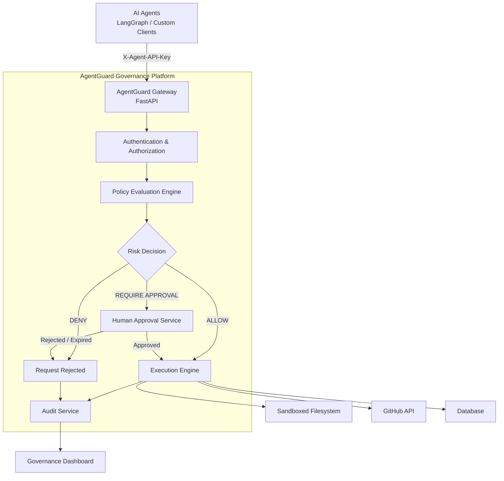
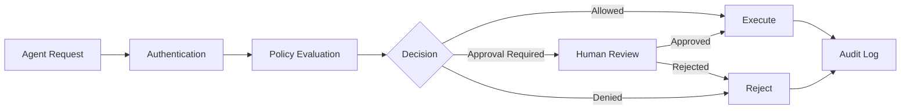

&#x20;\<div align="center">
&#x20; \

# 🛡️ AgentGuard

### The Security & Governance Layer for Autonomous AI Agents

**Govern the Agents. Control the Execution. Trust the Process.**

&#x20; \<p>     \     \     \     \     \     \   \</p>

&#x20; \<p>     \<b>AI Agent Security · Policy Enforcement · Human-in-the-Loop · Auditability\</b>   \</p> \</div>

---

## 🚀 What is AgentGuard?

**AI agents are becoming powerful enough to interact with real enterprise systems. But autonomy without governance creates risk.**

What happens when an AI agent attempts to delete a production database, modify a sensitive file, or access an unauthorized resource?

AgentGuard introduces a centralized governance layer between autonomous AI agents and the tools they use.

It authenticates agents, evaluates every tool invocation against security policies, enforces risk-based authorization, routes sensitive operations for human approval, and maintains an auditable execution history.

Instead of blindly trusting AI agents, AgentGuard ensures that their actions remain controlled, authorized, and traceable.

> **The goal: Give AI agents the ability to act, without giving them unrestricted authority.**

---

## ✨ Key Features

| Feature                     | Description                                                        |
| --------------------------- | ------------------------------------------------------------------ |
| 🧠 Multi-Agent Governance   | Manage and authenticate multiple AI agents independently           |
| 🔐 Agent Authentication     | API-key-based agent identity and JWT user authentication           |
| ⚖️ Risk-Based Policy Engine | Evaluate operations based on tool permissions, risk, and arguments |
| 👤 Human-in-the-Loop        | Require human authorization for sensitive operations               |
| ⚙️ Secure Execution Gateway | Centralized execution of filesystem, GitHub, and database tools    |
| 🔗 Tamper-Evident Auditing  | SHA-256 linked audit records for execution traceability            |
| ⏱️ Approval Expiry          | Automatically expire pending authorization requests                |
| 📊 Governance Dashboard     | Monitor agents, policies, approvals, and audit activity            |
| 🛑 Fail-Closed Security     | Deny operations without a matching authorization policy            |

---

## 🏗️ System Architecture



### 🔄 Request Lifecycle



Every tool invocation follows a controlled lifecycle:

1. **Authenticate:** Validate the agent identity and API credentials.
2. **Evaluate:** Match the requested operation against security policies.
3. **Assess:** Determine the risk and authorization requirements.
4. **Approve:** Route sensitive operations to an authorized human.
5. **Execute:** Invoke the appropriate tool handler.
6. **Audit:** Record the decision and execution lifecycle.

---

## 🖥️ Application Screenshots

The following sections are intended for genuine screenshots captured from the running application.

\<div align="center">

### 01. Governance Dashboard

\

*Centralized overview of agents, tool invocations, approvals, and security activity.*

---

### 02. Policy Management

\

*Configure tool permissions, risk levels, and authorization decisions.*

---

### 03. Human Approval Workflow

\

*Review, approve, or reject sensitive AI agent operations.*

---

### 04. Audit Logs & Telemetry

\

*Inspect agent activity, execution outcomes, and audit records.*

---

\</div>

---

## 🔐 Core Governance Capabilities

### 1. Risk-Based Policy Engine

AgentGuard evaluates tool invocations using configurable authorization rules.

- Tool-specific policies.
- Risk classifications: LOW, MEDIUM, HIGH, CRITICAL.
- Allow, deny, and approval-required decisions.
- Argument-based policy conditions.
- Policy priorities and allowlists/denylists.
- Default-deny behavior for unmatched requests.

### 2. Human-in-the-Loop Authorization

Sensitive operations can be routed through a human approval workflow.

- Pending approval requests.
- Approval and rejection actions.
- Approval expiry handling.
- Argument integrity verification.
- Execution only after valid authorization.

### 3. Secure Tool Execution

AgentGuard provides controlled access to organizational resources.

| Integration | Supported Operations                                                                |
| ----------- | ----------------------------------------------------------------------------------- |
| Filesystem  | List, read, create, update, delete                                                  |
| GitHub      | List repositories, get repository, create issue, create branch, update/delete files |
| Database    | Execute SELECT, inspect schema, insert, update, delete                              |

### 4. Multi-Agent Identity

Each registered agent receives an individual API credential and operates under the configured governance policies.

### 5. Tamper-Evident Audit Trail

AgentGuard maintains SHA-256 linked audit records to support traceability and integrity verification.

### 6. Role-Based Access Control

| Role             | Access                                                |
| ---------------- | ----------------------------------------------------- |
| Administrator    | Users, agents, policies, approvals, audit records     |
| Developer        | Tool access and personal audit telemetry              |
| Approver         | Approval queues and audit records                     |
| Security Officer | Policy management and organization-wide audit records |

---

## ⚖️ Default Governance Policies

| Tool                      | Risk     | Decision         |
| ------------------------- | -------- | ---------------- |
| `filesystem.list_files`   | LOW      | ALLOW            |
| `filesystem.read_file`    | LOW      | ALLOW            |
| `filesystem.create_file`  | MEDIUM   | REQUIRE_APPROVAL |
| `filesystem.update_file`  | MEDIUM   | REQUIRE_APPROVAL |
| `filesystem.delete_file`  | HIGH     | REQUIRE_APPROVAL |
| `github.list_repos`       | LOW      | ALLOW            |
| `github.get_repo`         | LOW      | ALLOW            |
| `github.create_issue`     | MEDIUM   | REQUIRE_APPROVAL |
| `github.create_branch`    | MEDIUM   | REQUIRE_APPROVAL |
| `github.delete_file`      | HIGH     | REQUIRE_APPROVAL |
| `database.execute_select` | LOW      | ALLOW            |
| `database.insert_record`  | MEDIUM   | REQUIRE_APPROVAL |
| `database.update_record`  | HIGH     | REQUIRE_APPROVAL |
| `database.delete_record`  | CRITICAL | REQUIRE_APPROVAL |
| Unknown operations        | —        | DENY             |

---

## 🧪 Governance Demonstration Scenarios

The demo client includes eight scenarios designed to demonstrate the governance lifecycle.

| #  | Scenario                   | Expected Outcome                         |
| -- | -------------------------- | ---------------------------------------- |
| 01 | Low-risk file read         | Automatically allowed                    |
| 02 | High-risk file deletion    | Human approval required                  |
| 03 | Critical database deletion | Human rejection                          |
| 04 | Path traversal attempt     | Denied                                   |
| 05 | Argument tampering         | Integrity verification failure           |
| 06 | Approval expiry            | Request expires without execution        |
| 07 | Multi-agent governance     | Individual agent identities maintained   |
| 08 | Audit inspection           | Execution lifecycle available for review |

---

## 🛡️ Security Architecture

| Security Layer       | Implementation                                      |
| -------------------- | --------------------------------------------------- |
| User Authentication  | JWT, HS256                                          |
| Password Security    | bcrypt                                              |
| Agent Authentication | SHA-256 hashed API keys                             |
| Argument Integrity   | Canonical JSON hashing                              |
| Approval Protection  | Single-use approvals and argument hash verification |
| Filesystem Security  | Sandboxed path validation                           |
| SQL Security         | Parameterized queries and SELECT validation         |
| Rate Limiting        | slowapi                                             |
| Audit Integrity      | SHA-256 hash chaining                               |
| Authorization        | Role-based access control                           |
| Default Policy       | Fail-closed authorization                           |
| Configuration        | Environment-based secrets                           |

---

## 🧰 Technology Stack

\<div align="center">

| Component        | Technology             |
| ---------------- | ---------------------- |
| Backend          | Python, FastAPI        |
| Frontend         | React 18, Vite         |
| Styling          | Tailwind CSS           |
| State Management | Zustand                |
| Data Fetching    | React Query            |
| Database         | PostgreSQL, SQLAlchemy |
| Background Jobs  | Celery                 |
| Message Broker   | Redis                  |
| Authentication   | JWT, bcrypt            |
| Agent Framework  | LangGraph              |
| Containerization | Docker, Docker Compose |
| Visualization    | Recharts               |

\</div>

---

## ⚡ Getting Started

### Prerequisites

- Docker and Docker Compose
- Python 3.12+
- Node.js 18+

### 1. Clone the Repository

```bash
git clone https://github.com/chiksharma221-ui/AGENTGUARD.git
cd AGENTGUARD
```

### 2. Configure Environment Variables

```bash
cp .env.example .env
```

Configure your environment:

- Set a secure `SECRET_KEY` (minimum 32 characters).
- Configure PostgreSQL and Redis connection settings.
- Optionally configure `GITHUB_TOKEN`.
- Configure `OPENAI_API_KEY` for the LangGraph demonstration.

**Never commit `.env` or real credentials to GitHub.**

### 3. Start with Docker Compose

```bash
docker compose up -d
```

The intended environment includes:

- PostgreSQL 16
- Redis 7
- AgentGuard Backend
- AgentGuard Frontend
- Celery Worker
- Celery Beat Scheduler

### 4. Access AgentGuard

| Service           | URL                                                          |
| ----------------- | ------------------------------------------------------------ |
| Dashboard         | [http://localhost:3000](http://localhost:3000)               |
| API Documentation | [http://localhost:8000/docs](http://localhost:8000/docs)     |
| Health Endpoint   | [http://localhost:8000/health](http://localhost:8000/health) |

### 5. Run Demo Agent Clients

```bash
cd agent-client
pip install -r requirements.txt
```

Configure the agent API keys generated by the seed process.

Run the governance scenarios:

```bash
python simple_mcp_client.py
```

Run the LangGraph demonstration:

```bash
python langgraph_agent.py
```

---

## 🔌 Agent Integration

AgentGuard exposes a centralized HTTP tool invocation endpoint.

```python
import httpx

response = httpx.post(
    "http://localhost:8000/mcp/invoke",
    headers={
        "X-Agent-API-Key": "ag_your_key_here"
    },
    json={
        "tool_name": "filesystem.read_file",
        "arguments": {
            "path": "report.txt"
        }
    }
)

print(response.json())
```

The gateway evaluates the request and returns the corresponding governance or execution status.

---

## 📡 API Reference

Interactive API documentation is available at:

`http://localhost:8000/docs`

| Endpoint                   | Method   | Description                   |
| -------------------------- | -------- | ----------------------------- |
| `/auth/login`              | POST     | Obtain JWT tokens             |
| `/auth/refresh`            | POST     | Refresh access token          |
| `/auth/me`                 | GET      | Current user information      |
| `/agents`                  | GET/POST | List and register agents      |
| `/agents/{id}/toggle`      | POST     | Enable or disable agent       |
| `/agents/{id}/credentials` | POST     | Generate agent API key        |
| `/mcp/invoke`              | POST     | Main tool invocation gateway  |
| `/mcp/tools`               | GET      | List registered tools         |
| `/mcp/result/{id}`         | POST     | Poll approval result          |
| `/policies`                | GET/POST | Manage policies               |
| `/policies/evaluate`       | POST     | Test policy evaluation        |
| `/approvals`               | GET      | Retrieve approval requests    |
| `/approvals/{id}/decide`   | POST     | Approve or reject request     |
| `/audit`                   | GET      | Query audit logs              |
| `/audit/export`            | GET      | Export audit records          |
| `/audit/stats`             | GET      | Retrieve telemetry statistics |
| `/ws/approvals`            | WS       | Approval event updates        |

---

## 📂 Project Structure

```text
AGENTGUARD/
│
├── backend/
│   ├── app/
│   │   ├── main.py
│   │   ├── config.py
│   │   ├── models/
│   │   ├── schemas/
│   │   ├── routers/
│   │   ├── services/
│   │   ├── mcp/
│   │   ├── core/
│   │   └── workers/
│   ├── alembic/
│   ├── scripts/
│   └── tests/
│
├── frontend/
│   └── src/
│       ├── pages/
│       ├── components/
│       ├── services/
│       ├── store/
│       └── hooks/
│
├── agent-client/
│   ├── simple_mcp_client.py
│   └── langgraph_agent.py
│
├── docs/
│   ├── ARCHITECTURE.md
│   ├── SECURITY.md
│   └── screenshots/
│
├── docker-compose.yml
├── .env.example
└── README.md
```

---

## 🔮 Future Scope

- Native MCP protocol transport and broader client compatibility.
- Advanced anomaly detection for agent behavior.
- Fine-grained organization and resource-level permissions.
- Policy simulation and versioning.
- Distributed agent governance.
- Enhanced observability and security analytics.

---

## 💡 The Bigger Idea

AI agents should be autonomous enough to be useful, but controlled enough to be trusted.

AgentGuard explores how organizations can introduce a governance layer around autonomous AI execution, bringing together authentication, authorization, policy enforcement, human oversight, and auditability.

**Autonomy without governance is risk. AgentGuard puts control back into the execution lifecycle.**

---

\<div align="center">

# 🛡️ AgentGuard

**Govern the Agents. Control the Execution. Trust the Process.**

Built with a focus on AI infrastructure, security engineering, and enterprise agent governance.

\</div>

---

### License

MIT License.
