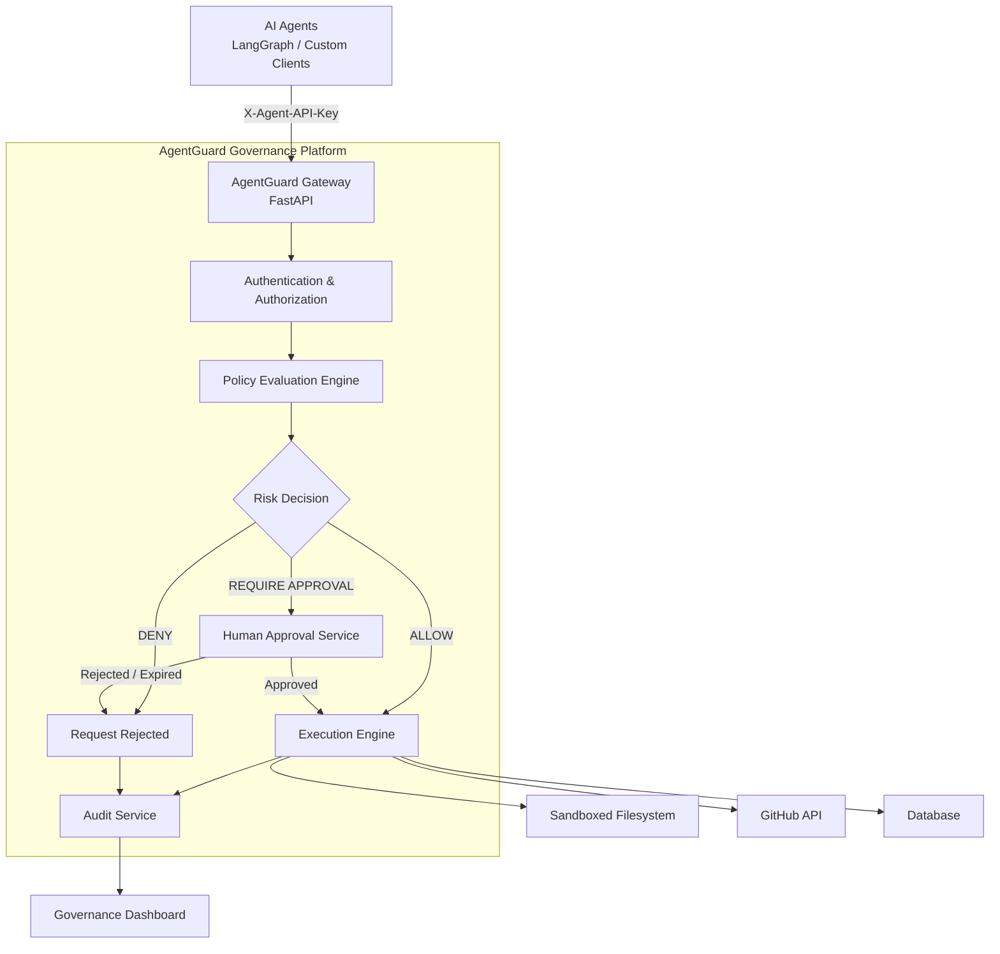
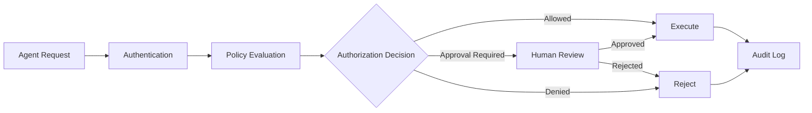

# AgentGuard

### The Security & Governance Layer for Autonomous AI Agents


**Govern the Agents. Control the Execution. Trust the Process.**

[](https://python.org)
[](https://fastapi.tiangolo.com/)
[](https://react.dev/)
[](https://postgresql.org/)
[](https://redis.io/)
[](https://docker.com/)

**AI Agent Security | Policy Enforcement | Human-in-the-Loop | Auditability**

---

## Overview

Autonomous AI agents are increasingly capable of interacting with enterprise systems, accessing files, modifying databases, managing repositories, and executing external tools.

However, granting agents access to organizational resources without proper governance introduces significant security risks.

What happens when an AI agent attempts to delete sensitive data, modify an unauthorized file, or execute a potentially destructive operation?

**AgentGuard introduces a centralized governance layer between autonomous AI agents and the tools they interact with.**

It authenticates agents, evaluates tool invocations against configurable security policies, enforces risk-based authorization, routes sensitive operations through human approval workflows, and maintains an auditable record of agent activity.

The objective is to enable autonomous execution while maintaining organizational control, accountability, and security.

## Key Features

| Capability | Description |
|---|---|
| Multi-Agent Governance | Register, authenticate, and manage multiple AI agents independently. |
| Agent Authentication | API-key-based agent identity and JWT-based user authentication. |
| Risk-Based Policy Engine | Evaluate operations using configurable permissions, risk levels, and argument conditions. |
| Human-in-the-Loop Approval | Require human authorization before executing sensitive operations. |
| Secure Execution Gateway | Centralized execution of filesystem, GitHub, and database tools. |
| Tamper-Evident Auditing | SHA-256-linked audit records for execution traceability. |
| Approval Expiry | Automatically expire pending authorization requests. |
| Governance Dashboard | Monitor agents, policies, approvals, and audit activity. |
| Fail-Closed Security | Deny operations without a matching authorization policy. |

---

## System Architecture



### Request Lifecycle



Every tool invocation follows a controlled lifecycle:

1. **Authenticate:** Validate the agent identity and API credentials.
2. **Evaluate:** Match the requested operation against configured security policies.
3. **Assess:** Determine risk and authorization requirements.
4. **Approve:** Route sensitive operations to an authorized human.
5. **Execute:** Invoke the appropriate tool handler after authorization.
6. **Audit:** Record the decision and execution lifecycle.

---

## Application Screenshots

### 1. Governance Dashboard


Centralized overview of registered agents, tool invocations, approvals, and security activity.

### 2. Policy Management


Configure tool permissions, risk classifications, and authorization decisions.

### 3. Human Approval Workflow


Review, approve, or reject sensitive AI agent operations.

### 4. Audit Logs and Telemetry


Inspect agent activity, execution outcomes, and audit records.

---

## Core Governance Capabilities

### 1. Risk-Based Policy Engine

AgentGuard evaluates tool invocations using configurable authorization rules.

- Tool-specific security policies.
- Risk classifications: LOW, MEDIUM, HIGH, CRITICAL.
- Allow, deny, and approval-required decisions.
- Argument-based policy conditions.
- Policy priorities and allowlists/denylists.
- Default-deny behavior for unmatched requests.

### 2. Human-in-the-Loop Authorization

Sensitive operations can be routed through a human approval workflow.

- Pending approval requests.
- Approval and rejection actions.
- Approval expiry handling.
- Argument integrity verification.
- Execution only after valid authorization.

### 3. Secure Tool Execution

AgentGuard provides controlled access to organizational resources.

| Integration | Supported Operations |
|---|---|
| Filesystem | List, read, create, update, delete |
| GitHub | List repositories, get repository, create issue, create branch, update/delete files |
| Database | Execute SELECT, inspect schema, insert, update, delete |

### 4. Multi-Agent Identity

Each registered agent receives an individual API credential and operates under configured governance policies.

### 5. Tamper-Evident Audit Trail

AgentGuard maintains SHA-256-linked audit records to support traceability and integrity verification.

### 6. Role-Based Access Control

| Role | Access |
|---|---|
| Administrator | Users, agents, policies, approvals, and audit records |
| Developer | Tool access and personal audit telemetry |
| Approver | Approval queues and audit records |
| Security Officer | Policy management and organization-wide audit records |

---

## Default Governance Policies

| Tool | Risk | Decision |
|---|---|---|
| `filesystem.list_files` | LOW | ALLOW |
| `filesystem.read_file` | LOW | ALLOW |
| `filesystem.create_file` | MEDIUM | REQUIRE_APPROVAL |
| `filesystem.update_file` | MEDIUM | REQUIRE_APPROVAL |
| `filesystem.delete_file` | HIGH | REQUIRE_APPROVAL |
| `github.list_repos` | LOW | ALLOW |
| `github.get_repo` | LOW | ALLOW |
| `github.create_issue` | MEDIUM | REQUIRE_APPROVAL |
| `github.create_branch` | MEDIUM | REQUIRE_APPROVAL |
| `github.delete_file` | HIGH | REQUIRE_APPROVAL |
| `database.execute_select` | LOW | ALLOW |
| `database.insert_record` | MEDIUM | REQUIRE_APPROVAL |
| `database.update_record` | HIGH | REQUIRE_APPROVAL |
| `database.delete_record` | CRITICAL | REQUIRE_APPROVAL |
| Unknown operations | — | DENY |

---

## Governance Demonstration Scenarios

The demo client includes eight scenarios designed to demonstrate the governance lifecycle.

| No. | Scenario | Expected Outcome |
|---|---|---|
| 1 | Low-risk file read | Automatically allowed |
| 2 | High-risk file deletion | Human approval required |
| 3 | Critical database deletion | Human rejection |
| 4 | Path traversal attempt | Denied |
| 5 | Argument tampering | Integrity verification failure |
| 6 | Approval expiry | Request expires without execution |
| 7 | Multi-agent governance | Individual agent identities maintained |
| 8 | Audit inspection | Execution lifecycle available for review |

---

## Security Architecture

| Security Layer | Implementation |
|---|---|
| User Authentication | JWT, HS256 |
| Password Security | bcrypt |
| Agent Authentication | SHA-256 hashed API keys |
| Argument Integrity | Canonical JSON hashing |
| Approval Protection | Single-use approvals and argument hash verification |
| Filesystem Security | Sandboxed path validation |
| SQL Security | Parameterized queries and SELECT validation |
| Rate Limiting | slowapi |
| Audit Integrity | SHA-256 hash chaining |
| Authorization | Role-based access control |
| Default Policy | Fail-closed authorization |
| Configuration | Environment-based secrets |

---

## Technology Stack

| Component | Technology |
|---|---|
| Backend | Python, FastAPI |
| Frontend | React 18, Vite |
| Styling | Tailwind CSS |
| State Management | Zustand |
| Data Fetching | React Query |
| Database | PostgreSQL, SQLAlchemy |
| Background Jobs | Celery |
| Message Broker | Redis |
| Authentication | JWT, bcrypt |
| Agent Framework | LangGraph |
| Containerization | Docker, Docker Compose |
| Visualization | Recharts |

---

## Getting Started

### Prerequisites

- Docker and Docker Compose
- Python 3.12+
- Node.js 18+

### 1. Clone the Repository

```bash
git clone https://github.com/chiksharma221-ui/AGENTGUARD.git
cd AGENTGUARD
```

### 2. Configure Environment Variables

```bash
cp .env.example .env
```

Configure the required environment variables:

- Set a secure `SECRET_KEY` of at least 32 characters.
- Configure PostgreSQL connection settings.
- Configure Redis connection settings.
- Optionally configure `GITHUB_TOKEN`.
- Configure `OPENAI_API_KEY` for the LangGraph demonstration.

Never commit `.env` files or real credentials to GitHub.

### 3. Start with Docker Compose

```bash
docker compose up -d
```

The Docker Compose environment is intended to start:

- PostgreSQL 16
- Redis 7
- AgentGuard Backend
- AgentGuard Frontend
- Celery Worker
- Celery Beat Scheduler

### 4. Access AgentGuard

| Service | URL |
|---|---|
| Dashboard | http://localhost:3000 |
| API Documentation | http://localhost:8000/docs |
| Health Endpoint | http://localhost:8000/health |

### 5. Run Demo Agent Clients

```bash
cd agent-client
pip install -r requirements.txt
```

Configure the agent API keys generated by the seed process.

Run the governance scenarios:

```bash
python simple_mcp_client.py
```

Run the LangGraph demonstration:

```bash
python langgraph_agent.py
```

The LangGraph demonstration requires an appropriate LLM API key.

---

## Agent Integration

AgentGuard exposes a centralized HTTP tool invocation endpoint.

Example using Python and HTTPX:

```python
import httpx

response = httpx.post(
    "http://localhost:8000/mcp/invoke",
    headers={
        "X-Agent-API-Key": "ag_your_key_here"
    },
    json={
        "tool_name": "filesystem.read_file",
        "arguments": {
            "path": "report.txt"
        }
    }
)

print(response.json())
```

The gateway evaluates the request and returns the corresponding governance or execution status.

---

## API Reference

Interactive API documentation is available at:

`http://localhost:8000/docs`

| Endpoint | Method | Description |
|---|---|---|
| `/auth/login` | POST | Obtain JWT tokens |
| `/auth/refresh` | POST | Refresh access token |
| `/auth/me` | GET | Current user information |
| `/agents` | GET/POST | List and register agents |
| `/agents/{id}/toggle` | POST | Enable or disable agent |
| `/agents/{id}/credentials` | POST | Generate agent API key |
| `/mcp/invoke` | POST | Main tool invocation gateway |
| `/mcp/tools` | GET | List registered tools |
| `/mcp/result/{id}` | POST | Poll approval result |
| `/policies` | GET/POST | Manage policies |
| `/policies/evaluate` | POST | Test policy evaluation |
| `/approvals` | GET | Retrieve approval requests |
| `/approvals/{id}/decide` | POST | Approve or reject request |
| `/audit` | GET | Query audit logs |
| `/audit/export` | GET | Export audit records |
| `/audit/stats` | GET | Retrieve telemetry statistics |
| `/ws/approvals` | WS | Approval event updates |

---

## Project Structure

```text
AGENTGUARD/
│
├── backend/
│   ├── app/
│   │   ├── main.py
│   │   ├── config.py
│   │   ├── models/
│   │   ├── schemas/
│   │   ├── routers/
│   │   ├── services/
│   │   ├── mcp/
│   │   ├── core/
│   │   └── workers/
│   ├── alembic/
│   ├── scripts/
│   └── tests/
│
├── frontend/
│   └── src/
│       ├── pages/
│       ├── components/
│       ├── services/
│       ├── store/
│       └── hooks/
│
├── agent-client/
│   ├── simple_mcp_client.py
│   └── langgraph_agent.py
│
├── docs/
│   ├── ARCHITECTURE.md
│   ├── SECURITY.md
│   ├── images/
│   └── screenshots/
│
├── docker-compose.yml
├── .env.example
└── README.md
```

---

## Future Scope

- Native MCP protocol transport and broader client compatibility.
- Advanced anomaly detection for agent behavior.
- Fine-grained organization and resource-level permissions.
- Policy simulation and versioning.
- Distributed agent governance.
- Enhanced observability and security analytics.

---

## Project Vision

AI agents should be autonomous enough to be useful, but controlled enough to be trusted.

AgentGuard explores how organizations can introduce a governance layer around autonomous AI execution, bringing together authentication, authorization, policy enforcement, human oversight, and auditability.

The objective is to make AI agent execution more secure, transparent, and accountable.

**Autonomy without governance is risk. AgentGuard puts control back into the execution lifecycle.**

---

## License

MIT License.

---

**AgentGuard**

Govern the Agents. Control the Execution. Trust the Process.
